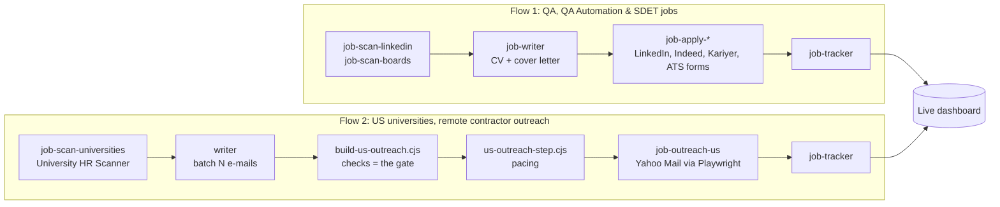

# AI Native Job Search Automatization

A job search run by AI agents. [Claude Code](https://claude.com/claude-code) sub-agents scan job boards, tailor CVs and cover letters, apply, and record every step on a live dashboard. Scheduled tasks keep it running without a human at the keyboard; the human only steps in for passwords, CAPTCHAs and real decisions.

There are two separate flows:



## What's in here

| Folder | Contents |
|---|---|
| `agents/` | 14 Claude Code sub-agents: scanners, the writer, one applier per job site, the US outreach sender and the tracker |
| `skills/job-search/` | The skill that holds the shared rules every agent follows |
| `scheduled-tasks/` | Prompts for the scheduled runs: the hourly LinkedIn scan, the weekday outreach sender, and the weekly university scanner + writer |
| `scripts/us-outreach/` | The outreach builder (validates every e-mail and builds the send queue) and the step script (all pacing rules, with a self-test) |
| `dashboard/` | The dashboard page: both flows as separate pipelines, dark theme |
| `tests/` | Builder tests on made-up fixtures, plus checks that every agent, skill and task definition loads |

## Guardrails

The rules live in code, so a scheduled run can't get them wrong:

- **Pacing:** one e-mail at a time, at least 25 minutes apart, at most 10 a day. Sends only on weekdays, 16:00–21:00 Ankara time.
- **Per university:** one e-mail a day, and the HR e-mail only on a later day than the student support e-mail.
- **Pre-send checks:** the address must still be on its official source page. The recipient, body and attachment are checked before the send button is pressed.
- **After sending:** the e-mail must show up in the Sent folder. Anything unexpected writes a STOP that blocks sending for the rest of the day.
- **No double sends:** rebuilding the queue never resets a status, so nothing is sent twice.
- **Off-limits for agents:** they never type passwords, verification codes or government IDs, and never solve CAPTCHAs.

## CI

Every push runs `.github/workflows/ci.yml`:

1. a syntax check of every script;
2. **personal-data guard** (`node sync.cjs --check`): it fails on phone numbers, personal e-mail addresses, salary figures or ID numbers;
3. checks that every agent, skill and task definition loads;
4. the pacing self-test;
5. the builder tests: a valid batch builds, and broken batches are refused (formal greeting, wrong spelling of Turkey, non-.edu address, duplicate address, missing metadata, false residency claims).

## Syncing

The agents run from their live locations (`~/.claude/agents`, `~/.claude/scheduled-tasks` and a local work folder). This repo is the versioned copy:

```powershell
node sync.cjs
git add -A
git commit -m "Sync"
git push
```

`sync.cjs` copies the live files in, redacts salary details, and refuses to finish if personal data slipped through. CVs, cover letters, answer files, logs and send queues never enter the repo (see `.gitignore`).
